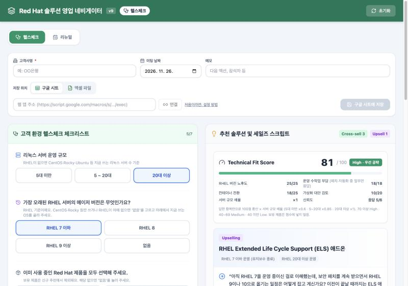
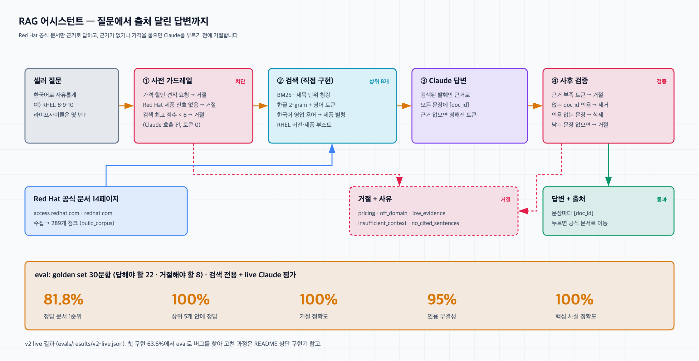
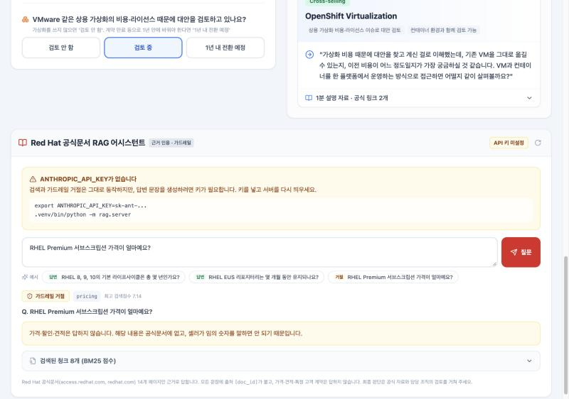

# Red Hat Solution Sales Navigator

고객의 RHEL 운영 환경과 과제를 체크하면 Red Hat 솔루션 후보, 추천 근거, 대화 시작 스크립트를 제안하고, Red Hat 공식 문서만 근거로 답하는 RAG 어시스턴트를 함께 제공하는 영업 지원 데모입니다.

> 개인 프로젝트입니다. Red Hat의 공식 도구가 아니며, 점수 배점·추천 규칙·대화 스크립트는 설명용 예시입니다. 실제 제품 구성, 자격 요건, 가격은 Red Hat 공식 자료와 담당 조직의 검토가 필요합니다.

관련 글: [구현기·측정 — 63.6%에서 시작해 eval로 버그를 잡기까지](https://hm-zy.github.io/posts/redhat-sales-navigator-rag-evals-build-log/)

## 한눈에 보기

설치나 API 키 없이 이 페이지만 보고도 무엇을 하는지 알 수 있도록, 실제 화면과 측정 결과를 모았습니다.

### 1. 체크리스트에 답하면 점수·추천·대화 스크립트가 나옵니다



미팅 유형(헬스체크 / 리뉴얼)을 고르고 고객 환경 질문에 답하면, 오른쪽에 **Technical Fit 점수**(100점, High·Medium·Low), Upsell / Cross-sell / Net-new 추천, 추천 근거, 미팅에서 바로 쓸 수 있는 한국어 스크립트와 1분 설명 자료가 표시됩니다.

### 2. RAG 어시스턴트는 공식 문서만 근거로 답합니다

<picture>
  <source media="(prefers-color-scheme: dark)" srcset="docs/images/rag-flow-dark.png">
  
</picture>

### 3. 실제 답변 예시

eval을 Claude로 실행했을 때 나온 답변 그대로입니다 (`evals/results/v2-live.json`, q01). 문장마다 근거 문서 `[doc_id]`가 붙습니다.

> **Q. RHEL 8, 9, 10은 기본 라이프사이클이 총 몇 년인가요?**
>
> RHEL 8, 9, 10의 기본 라이프사이클은 Full Support 및 Maintenance Support 단계를 합쳐 총 10년이며, 그 이후 Extended Life Phase가 이어집니다 [rhel-lifecycle].
> Extended Life Cycle Premium (ELCP)과 Long-Life (LL) Add-On term extensions를 활용하면, 적격 마이너 릴리스에서 최대 14년(및 그 이상)까지 errata 지원을 받을 수 있습니다 [rhel-lifecycle].

### 4. 가격 질문은 Claude를 부르기 전에 거절합니다



공식 문서에는 가격이 없으므로, 가격·할인·견적 질문은 모델을 호출하지 않고 거절합니다. 이 화면은 API 키 없이 찍은 것으로, 거절과 검색은 키 없이도 동작합니다.

### 5. eval 결과 (v2, 30문항)

| 지표 | 결과 |
|---|---|
| 정답 문서가 검색 1순위 | 18/22 (81.8%) |
| 정답 문서가 상위 5개 안 | 22/22 (100%) |
| 거절해야 할 질문을 거절 | 8/8 (100%) |
| 답해야 하는데 거절 (과잉 거절) | 2/22 (9.1%) |
| 인용 무결성 (인용이 실제 근거와 일치) | 19/20 (95%) |
| 핵심 사실 정확도 | 20/20 (100%) |

63.6%에서 시작해 eval로 버그를 찾아 고친 과정은 위 구현기에 정리했습니다. 지표별 버전 비교는 아래 [RAG 어시스턴트와 eval](#rag-어시스턴트와-eval-python) 절에 있습니다.

## 기능

- **미팅 유형 두 가지**: 헬스체크(고객 환경 점검 7문항) / 리뉴얼(구독 갱신 8문항), 탭마다 색이 다름
- **Technical Fit 점수** (헬스체크): 답변으로 고객의 기술적 적합도를 100점·High/Medium/Low로 계산, 항목별 근거 표시
- **추천**: Upsell / Cross-sell / Net-new(RHEL·Red Hat 제품이 없는 고객) 솔루션과 추천 근거
- **대화 지원**: 바로 쓸 수 있는 한국어 스크립트 + 공감 → 문제 → 해결 → 다음 단계의 1분 설명 자료와 공식 문서 링크
- **Red Hat 공식문서 RAG 어시스턴트**: 브라우저에서 질문하면 출처 `[doc_id]`가 붙은 답변, 가격·범위 밖 질문은 가드레일로 거절
- **미팅 기록 저장**: 로컬 엑셀(`.xlsx`) 또는 구글 시트에 미팅 유형별 탭으로 한 줄씩
- 이미 고른 답을 다시 누르면 선택 해제, 입력 초기화

## 실행

```bash
npm install
npm run dev        # http://localhost:5173
```

프로덕션 빌드는 `npm run build`로 생성합니다.

```bash
npm test           # vitest — 점수·추천·엑셀·시트 기록 로직 단위 테스트
npm run api        # 로컬 RAG API 서버 (rag.server, 포트 8000)
npm run build:file # 서버 없이 더블클릭으로 여는 단일 HTML (dist-file/sales-navigator.html)
```

### 엑셀 저장

상단 저장 바에서 저장 위치를 **엑셀 파일**로 고르고 고객사명·미팅 날짜·메모와 체크리스트를 입력한 뒤 저장하면, 고른 `.xlsx` 파일의 **'헬스체크' 또는 '리뉴얼' 시트**(지금 탭) 맨 아래에 한 줄이 추가됩니다. 파일은 [File System Access API](https://developer.mozilla.org/docs/Web/API/File_System_Access_API)로 직접 쓰므로 **Chrome 또는 Edge**에서만 동작하고(그 외 브라우저는 안내 문구만 표시), 서버로 고객 정보가 전송되지 않습니다. 한 번 고른 파일은 브라우저(IndexedDB)에 기억해 다음 미팅에서 그대로 이어 씁니다.

### RAG 어시스턴트까지 함께 띄우기

화면 아래 'Red Hat 공식문서 RAG 어시스턴트' 카드는 로컬 API 서버(`rag/server.py`, 포트 8000)를 `/api` 프록시로 호출합니다. 터미널 두 개로 실행합니다.

```bash
# 터미널 1 — RAG API (HTTP 서버·검색·청킹은 표준 라이브러리, 파이프라인 의존성은 anthropic)
python3 -m venv .venv && .venv/bin/pip install -r requirements.txt
.venv/bin/python -m rag.build_corpus      # 공식문서 최초 1회 수집
.venv/bin/python -m rag.server            # http://localhost:8000

# 터미널 2 — 웹
npm install
npm run dev                               # http://localhost:5173  (→ /api 는 8000으로 프록시)
```

답변 생성을 쓰려면 터미널 1에서 `export ANTHROPIC_API_KEY=sk-ant-...` 후 서버를 띄웁니다. 키가 없어도 검색과 가드레일 거절(가격·범위 밖)은 그대로 동작하고, 답변이 필요한 질문에만 키 설정 안내가 옵니다.

카드 우측 상단 배지가 서버·코퍼스·API 키 상태를 보여줍니다. 서버가 꺼져 있으면 무엇을 실행해야 하는지 카드 안에 표시되고, 옆의 새로고침 아이콘으로 다시 확인할 수 있습니다.

서버 없이 쓰는 단일 HTML 파일(`npm run build:file`)과 Apps Script 웹 앱(`npm run build:gas`)에는 로컬 API 서버가 없으므로 RAG 카드는 숨겨집니다.

| 엔드포인트 | 요청 | 응답 |
|---|---|---|
| `GET /api/health` | — | `{ok, corpus_ready, has_api_key, chunks, model}` |
| `POST /api/ask` | `{"question": "..."}` | `{status, reason, answer, citations, sources, retrieved, top_score}` |

`status`는 `answered`(답변) / `refused`(가드레일 거절, `reason` = `pricing`·`off_domain`·`low_evidence`·`insufficient_context`·`no_cited_sentences`) / `unavailable`(코퍼스·키 없음)입니다. `retrieved`에는 검색된 청크의 제목·URL·BM25 점수가 담깁니다.

## 기술 스택

React, TypeScript, Vite, Tailwind CSS, lucide-react, exceljs · Python(RAG API, 표준 라이브러리 + anthropic) · Google Apps Script(시트 저장, 선택)

## 화면 구성

### 헬스체크 / 리뉴얼

화면 위쪽 탭에서 미팅 유형을 고릅니다. 두 탭의 입력은 따로 유지되고, 초기화는 지금 탭만 지웁니다.

- **헬스체크**: 고객 환경 점검 7문항 (규모, RHEL 버전, 보유 제품, 패치·보안, 자동화, 컨테이너, 가상화)
- **리뉴얼**: 갱신 미팅용 8문항 (보유 제품, 구독 수량 대비 실제 서버, 지원 등급, 핵심 시스템, 호스트당 VM 수, 1년 내 큰 작업, 패치·보안, 기술 지원 아쉬움). 추천: 구독 수량 정합화, Premium 지원, RHEL for Virtual Datacenters, Smart Management, TAM (Upselling) / Ansible Automation Platform, OpenShift (Cross-selling)
- 탭마다 색이 다릅니다 (헬스체크 = 초록, 리뉴얼 = 남색). 헤더·탭 버튼·체크리스트 제목·저장 버튼이 함께 바뀝니다.

### Technical Fit 점수 · Net-new · 1분 설명 자료 (헬스체크)

**Technical Fit 점수 (100점 만점)**: 고객 환경에 Red Hat 제품이 들어갈 기술적 여지를 점수로 매깁니다. 추천 패널 맨 위 카드에 항목별 점수가 보이고, 시트에 `Technical Fit 점수`, `Fit 등급` 열로 저장됩니다.

- 신호 4가지: RHEL 버전 노후도 25 (RHEL이 없으면 'RHEL 신규 도입' 25) + 운영 수작업 부담 30 (패치 12 + 자동화 18) + 컨테이너 전환 25 + 가상화 대안 20
- 답한 항목만으로 100점 환산 후 서버 규모 배율을 곱합니다 (5대 미만 ×0.6, 5~20대 ×0.85, 20대 이상 ×1)
- 등급: 70 이상 High (우선 공략), 40~69 Medium (육성), 40 미만 Low (관망). 6문항 중 5개 미만이면 '잠정'
- 보유 제품은 점수에 넣지 않고 추천 중복을 빼는 데만 씁니다
- 패치 부담(거의 없음 0 · 일부 3 · 크다 12)과 가상화(검토 안 함 0 · 검토 중 10 · 1년 내 전환 20)는 3단계로 묻습니다. '크다'를 고르면 감사 지적·장애 경험을 짚는 대본이 나옵니다
- 배점은 1차값입니다. 시트 기록이 쌓이면 실제 수주 고객 점수와 비교해 기준선을 조정하세요

**Net-new (RHEL·Red Hat 제품이 없는 고객)**: RHEL 버전에서 '없음'을 고르면 지금 쓰는 OS(CentOS 계열 25 · 다른 리눅스 18 · Windows 6)를 묻고, 'RHEL 신규 도입' 추천을 냅니다. Red Hat 제품이 하나도 없으면 모든 추천이 Net-new로 분류됩니다. 패치 부담이 있거나 서버를 수작업으로 운영하면 Smart Management(Satellite)를 묶어 제안합니다. 시트에 `현재 OS (RHEL 미사용)` 열이 추가됩니다.

**1분 설명 자료**: 추천 카드마다 대본 아래 '1분 설명 자료 · 공식 링크'를 펼치면 공감 → 문제 → 해결 → 다음 단계 흐름과 Red Hat 공식 페이지 링크가 나옵니다 (`src/briefs.ts`).

**그 밖에**: 이미 고른 답을 다시 누르면 선택이 풀립니다. 서버 규모 구간을 5대 미만 / 5~20대 / 20대 이상으로 낮췄습니다.

### 구글 시트에 저장 (선택)

#### 방법 A: Apps Script 웹 앱이 화면까지 띄우기 (Google Workspace 조직 계정, 여러 명이 함께)

조직 계정에서는 웹 앱 액세스를 '모든 사용자'로 열 수 없는 경우가 많아 방법 B가 막힙니다. 대신 네비게이터 화면 자체를 시트의 Apps Script 웹 앱이 보여 줍니다. 사용자는 웹 앱 주소를 브라우저에서 조직 계정으로 열면 되고, 설치도 HTML 파일 복사도 필요 없습니다.

```bash
npm run build:gas
```

1. 시트의 **확장 프로그램 → Apps Script**에서 `Code.gs`에 `dist-gas/Code.gs` 내용을, HTML 파일 `index`에 `dist-gas/index.html` 내용을 붙여넣고 저장합니다.
2. **배포 → 새 배포 → 웹 앱**, 실행 사용자 **웹 앱에 액세스하는 사용자**, 액세스 권한 **조직 내 사용자**로 배포합니다.
3. 구글 시트를 함께 쓸 사람에게 **편집자**로 공유합니다. 공유받은 사람만 저장할 수 있고, 아니면 "편집 권한이 없습니다" 안내가 뜹니다.
4. 사용자는 `…/exec` 주소를 열고 처음 한 번 권한을 허용합니다. 저장하면 **작성자** 열에 각자의 구글 계정 이메일이 들어갑니다(화면에서 바꿀 수 없음).
5. 코드를 고치면 다시 빌드해 붙여넣고 **배포 관리 → 수정 → 새 버전**으로 배포합니다(주소는 그대로).

엑셀 저장과 Q&A는 이 화면에 없습니다.

#### 방법 B: HTML 파일에서 시트로 보내기 (개인 Gmail 계정)

저장 바의 **저장 위치**에서 **구글 시트**와 **엑셀 파일** 중 하나를 고릅니다. 구글 시트는 시트에 붙인 Apps Script 웹 앱으로 기록을 보내므로, 서버 없이 HTML 파일 하나로 동작하고 PC의 파일 쓰기 정책과도 상관없습니다(인터넷만 필요).

처음 한 번만 설정합니다. 화면의 **처음이라면: 설정 방법**에도 같은 안내와 스크립트 복사 버튼이 있습니다.

1. [sheets.new](https://sheets.new)에서 새 구글 시트를 만듭니다.
2. 시트 메뉴 **확장 프로그램 → Apps Script**를 열고, [`apps-script/Code.gs`](apps-script/Code.gs) 내용을 붙여넣고 저장합니다.
3. **배포 → 새 배포 → 유형: 웹 앱**, 실행 사용자 **나**, 액세스 권한 **모든 사용자**로 배포하고 권한을 승인합니다.
4. 나온 웹 앱 주소(`https://script.google.com/macros/s/.../exec`)를 네비게이터에 붙여넣고 **연결**을 누릅니다. 주소는 이 브라우저에 기억됩니다.

- 열은 엑셀과 같고, `미팅 기록` 시트에 한 줄씩 추가됩니다. 새 질문 열은 오른쪽에 붙습니다.
- 웹 앱 주소를 아는 사람은 시트에 줄을 추가할 수 있습니다(읽기는 불가). 주소를 공유하지 마세요.
- 고객사명과 미팅 내용이 구글 계정으로 저장되니, 소속 조직의 보안 정책을 먼저 확인하세요.
- 스크립트를 고치면 **배포 → 배포 관리 → 수정 → 새 버전**으로 다시 배포해야 반영됩니다(주소는 그대로).

### 서버 없이 HTML 파일 하나로 실행

```bash
npm run build:file
```

`dist-file/sales-navigator.html` 파일 하나가 만들어집니다. 이 파일을 원하는 곳에 두고 **Chrome으로 더블클릭해서 열면** 됩니다. `npm run dev`도, localhost도 필요 없습니다.

- JS, CSS, exceljs를 모두 HTML 안에 넣었습니다(약 1.1MB). Chrome은 `file://`에서 분리된 스크립트 파일을 불러오지 않기 때문입니다.
- 체크리스트, 점수, 추천, 엑셀·구글 시트 저장이 그대로 동작합니다.
- **공식 문서 Q&A 창은 이 파일에 없습니다.** API 키를 지키려면 Python 서버가 필요하기 때문입니다. Q&A가 필요하면 `npm run api` + `npm run dev`로 엽니다.
- 코드를 고친 뒤에는 `npm run build:file`을 다시 실행해 파일을 새로 만들어야 합니다.

## RAG 어시스턴트와 eval (Python)

Red Hat 공식 문서(access.redhat.com, redhat.com 14개 페이지)만 근거로 셀러 질문에 답하고, 모든 문장에 출처 `[doc_id]`를 붙이는 RAG 파이프라인입니다.

```
rag/sources.json      수집 대상 공식 문서 목록 (doc_id, URL, 제품 태그)
rag/build_corpus.py   문서를 받아 본문 텍스트로 저장 (rag/corpus/, git에는 올리지 않음)
rag/retrieval.py      제목 단위 sliding-window 청킹, 직접 구현한 BM25, RHEL 버전·제품 부스트
rag/text.py           영어 단어 + 한글 2-gram 토크나이저
rag/aliases.py        한국어 영업 용어 → 영문 제품 용어 별칭 맵
rag/guardrails.py     사전 차단(가격·범위 밖·근거 부족) / 사후 검증(인용 누락·가짜 인용·근거 부족 응답)
rag/pipeline.py       검색 → 사전 차단 → Claude 호출 → 인용 검증
rag/server.py         로컬 HTTP API (표준 라이브러리 http.server): GET /api/health, POST /api/ask
src/RagAssistant.tsx  웹의 RAG 질문 UI (예시 질문, 답변·인용·거절 배지, 검색 청크)
evals/golden.jsonl    32문항 (답해야 할 23 + 거절해야 할 9 — 블로그 정리 글의 30문항은 v1·v2 기준, v3에서 가격 회귀 확인 2문항 추가)
evals/run_eval.py     검색 전용 / live Claude 평가
tests/test_rag.py     단위 테스트
tests/test_server.py  로컬 API 테스트 (인덱스·모델·키 상태를 주입, 네트워크 없음)
```

```bash
python3 -m venv .venv && .venv/bin/pip install -r requirements.txt
.venv/bin/python -m rag.build_corpus                 # 공식 문서 수집
.venv/bin/python -m unittest discover -s tests -t .  # 단위 테스트
.venv/bin/python -m evals.run_eval                   # 검색 전용 eval (API 호출 없음)
.venv/bin/python -m evals.run_eval --live            # Claude 호출 eval (ANTHROPIC_API_KEY 필요)
.venv/bin/python -m rag.pipeline "RHEL 8 지원 종료는 언제인가요?"
```

새로 실행한 결과는 `evals/results/<mode>-<시각>.json`으로 저장되고, 아래 파일은 버전별 결과를 이름 붙여 보관한 것입니다.

| 버전 | 변경 | 파일 |
|---|---|---|
| v0 | 첫 구현 | `v0-baseline-retrieval.json` |
| v1 | 여러 페이지에 반복되는 사이트 메뉴 줄 제거, 별칭 확장어 가중치 0.5, 질문에 나온 제품의 문서 우선 | `v1-retrieval.json`, `v1-live.json` |
| v2 | live eval에서 찾은 문제 수정: 마침표 뒤에 붙은 인용을 다음 문장으로 잘못 넘기던 버그, 한국어 단위·기간 표현(개월, 주기) 별칭, Claude에게 주는 청크 5개 → 8개 | `v2-retrieval.json`, `v2-live.json` |
| v3 | 가격 가드레일 정교화: "비용" 한 단어만으로 기술·영업 맥락("VMware 비용 때문에", "비용 절감")까지 거절하던 과잉 차단 수정, 실제 가격·견적·금액 요청은 그대로 차단. 회귀 확인용 2문항 추가 | `v3-retrieval.json` |

문서 단위 Top-1은 "맞는 문서"만 보므로, 답이 있는 문단이 빠져도 맞은 것으로 셉니다. v1 live에서 Claude가 "근거 부족"으로 답한 6건이 이 경우였습니다. v1~v2는 같은 30문항으로 반복 측정했으므로 그 수치에는 과적합 가능성이 있습니다. v3에서 가격 가드레일 회귀 확인용 2문항(q23 비용 맥락, r09 라이선스 금액)을 더해 32문항이 되었고, v3 결과는 이전 버전과 1:1 비교하지 않습니다. 문항은 Claude가 코퍼스 원문을 보고 초안을 썼고, 사람이 직접 검토해야 합니다. `build_corpus`는 실행 시점의 공식 페이지를 내려받으므로, 원문이 개정되면 청크 수와 수치가 조금 달라질 수 있습니다.

## 범위

이 프로젝트는 세일즈 대화 흐름을 설명하기 위한 프런트엔드 PoC입니다. 실제 제품 구성, 자격 요건, 가격 및 라이선스 안내는 Red Hat 공식 자료와 담당 조직의 검토가 필요합니다. 고객 정보는 서버로 보내지 않고 사용자가 고른 엑셀 파일이나 본인 구글 시트에만 저장됩니다.
